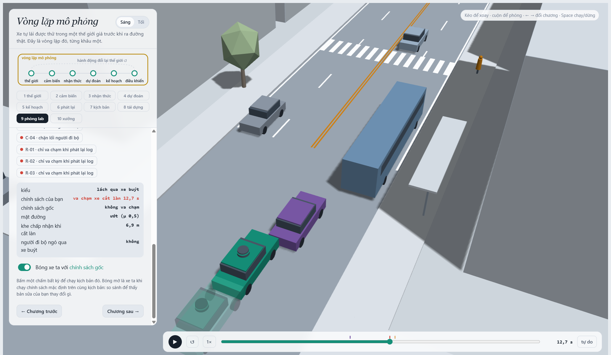
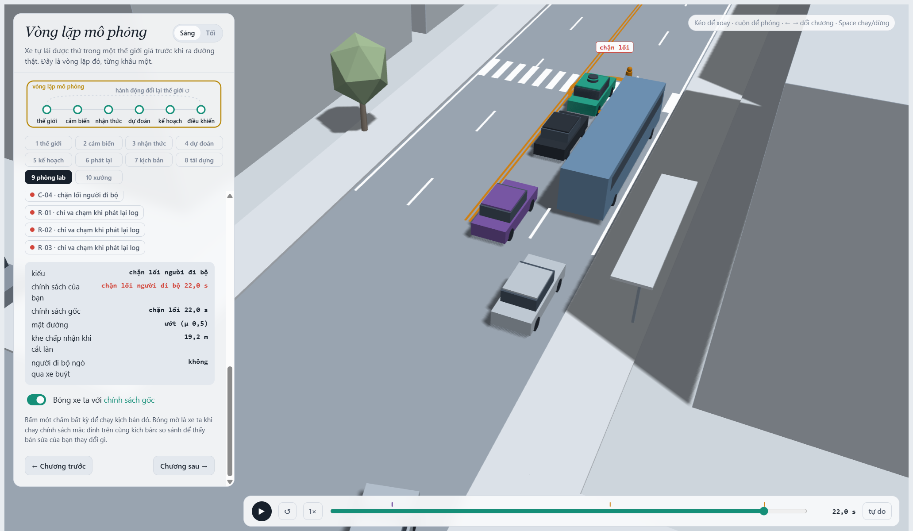
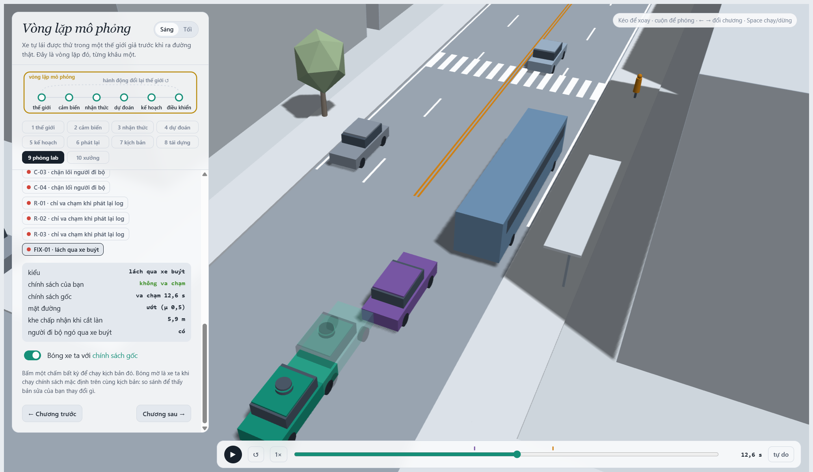
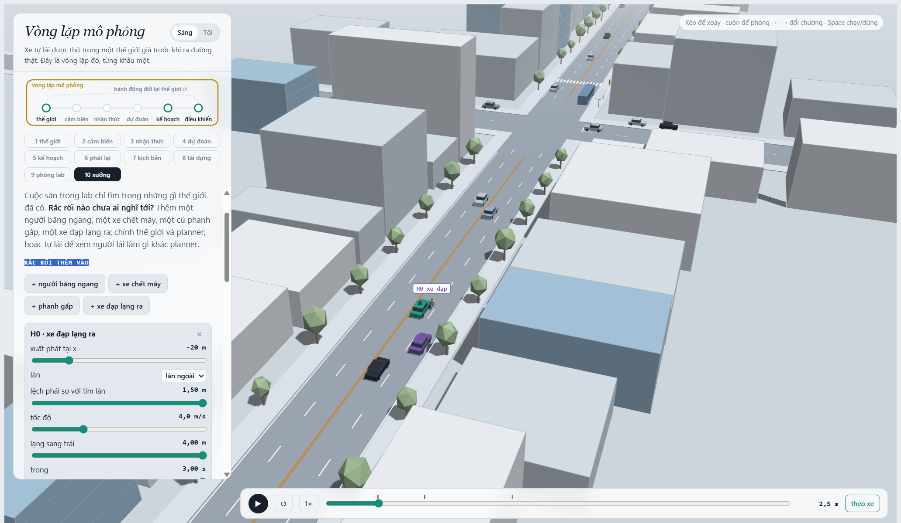

MSSV: 202602947

# Lab 11 · Scenario Forge — báo cáo

Mỗi câu: trả lời ngắn, **trích số từ `evidence/`** (ghi tên file và trường, ví dụ `mc.json: crashes = 4`). Grader chạy lại với MSSV của bạn; số không khớp `evidence/` thì mất điểm phần D (RUBRIC), và câu dựa trên số sai khó được điểm đầy đủ. Không cần văn hay: một bảng nhỏ và hai, ba câu giải thích là đủ.

Thị trấn của bạn (`meta.json: _run.town`): B.

## 1. Phát lại log có trung thực không? (bước A)

Trong `replay.json`: bao nhiêu kịch bản bị bỏ vì người lái gây va chạm, bao nhiêu va chạm khi planner chạy trên log phát lại, bao nhiêu trong thế giới phản ứng, theo từng loại tiếp xúc. Giải thích vì sao phần lớn va chạm của "phát lại" là `rear`, và vì sao đó là va chạm **giả**. Chọn một kịch bản trong `replay_only` và nói chuyện gì đã xảy ra.

**Trả lời:** Không phải bỏ log nào. `replay.json` có 99 va chạm khi phát lại (92 `rear`, 7 `side`), nhưng 0 trong giao thông phản ứng. Ở kịch bản 4, xe TG tông đuôi ego trong log phát lại; đây là va chạm giả vì TG cứ chạy theo log cũ, không biết planner đã làm gì khác người lái ban đầu.

## 2. Kịch bản bất khả thi (bước B)

Liệt kê các luật trong `is_feasible` và căn cứ vật lý của từng luật (ma sát, gia tốc, tốc độ người). Trong `hunt.json`, cuộc săn nào sinh nhiều kịch bản bất khả thi nhất, và vì sao CEM lại bị kéo về phía đó? Điều gì xảy ra với ước lượng nếu bạn **đếm** chúng là va chạm?

**Trả lời:** `is_feasible` loại chuyển làn cần gia tốc ngang lớn hơn $\mu g$, phanh vượt $\mu g$, người đi bộ chạy nhanh hơn 2.5 m/s, hoặc xe cắt làn chạy ngoài khoảng 0–22 m/s. Đây là giới hạn bám đường và tốc độ hợp lý. Săn `crosswalk_block` loại nhiều nhất: 14 cảnh (`hunt.json`), vì CEM tìm điểm nguy hiểm mà không tự hiểu giới hạn vật lý. Nếu tính các cảnh đó là va chạm, xác suất sẽ bị thổi phồng bởi những tình huống không thể xảy ra.

## 3. Monte Carlo cho bạn biết gì (bước C1)

`mc.json`: k, n, p̂ và khoảng Wilson 95 %. Với p̂ đó, cần bao nhiêu lần chạy để khoảng tin cậy hẹp lại còn ±20 % của p? Có kiểu thất bại nào **chưa hề xuất hiện** trong 3 000 lần chạy không? Con số đúng cần báo cho kiểu đó là gì?

**Trả lời:** `mc.json` ghi 6 va chạm trong 3,000 lượt: $\hat p=0.002$, Wilson 95% $[0.000917,\,0.004357]$. Muốn sai số tương đối khoảng 20% cần xấp xỉ $96/p=48{,}000$ lượt. Không thấy `cut_in`, `crosswalk_block`, `rear_ended` hay `other`; với mỗi kiểu, cận trên 95% là 0.001279 (`mc.json: per_mode.*.hi`), không phải xác suất bằng 0.

## 4. Importance sampling, ESS và độ suy biến (bước C3)

Bảng: với từng kiểu và từng seed trong `estimate.json`, ghi `p`, `hits`, `ess`, `top_share`. Ba seed có đồng ý với nhau không, và có đồng ý với Monte Carlo không? Ở đâu `top_share` lớn (> 0,5), và vì sao khi đó con số thực ra chỉ là trọng số của một mẫu? So ngân sách (`budget`) với số lần chạy Monte Carlo cần để có cùng độ chính xác. Phần `other` trong tổng lấy từ đâu, và vì sao không săn nó?

**Trả lời:** `estimate.json` dùng ngân sách 16,800 rollout. Bảng ghi `p / hits / ess / top_share` theo từng seed:

| Kiểu | Seed 0 | Seed 1 | Seed 2 |
|---|---|---|---|
| `bus_bypass` | 3.40e-4 / 67 / 110.9 / 0.366 | 1.11e-4 / 51 / 132.6 / 0.177 | 4.58e-4 / 70 / 133.8 / 0.183 |
| `cut_in` | 0* / 0 / 125.7 / 0; upper 0.025 | 0* / 0 / 121.4 / 0; upper 0.025 | 0* / 0 / 128.1 / 0; upper 0.025 |
| `crosswalk_block` | 2.39e-6 / 51 / 129.1 / 0.762 | 2.78e-7 / 48 / 113.7 / 0.416 | 4.65e-7 / 45 / 105.1 / 0.365 |
| `rear_ended` | 0* / 0 / 115.6 / 0; upper 0.025 | 0* / 0 / 106.2 / 0; upper 0.025 | 0* / 0 / 114.6 / 0; upper 0.025 |

*`p=0` ở đây chỉ là không thấy hit trong mẫu; không có nghĩa xác suất thật bằng 0. Cận trên mỗi seed là 0.025. Ba seed cho tổng 3.42e-4, 1.11e-4 và 4.58e-4, chênh nhau khá nhiều và đều thấp hơn MC 0.002. `crosswalk_block` ở seed 0 có `top_share=0.762`: một mẫu đóng góp hơn ba phần tư ước lượng. IS dùng budget 16,800, ít hơn khoảng 48,000 lượt MC cần cho độ chính xác tương đối 20%, nhưng ESS mỗi seed chỉ khoảng 105–134. `other` lấy từ MC: 0/3000, cận trên 0.001279; không săn riêng vì không có một điểm nguy hiểm cụ thể để CEM bám theo (`estimate.json`).

## 5. Các kiểu thất bại (bước C2 + 3D)

Mỗi kiểu bạn tìm thấy: một ảnh chụp trình xem 3D (chương 9) ở đúng lúc va chạm, và một câu mô tả chuỗi sự kiện (ai thấy gì, ai chờ gì). Kiểu nào cuộc săn **không** tìm thấy, và bạn tin điều đó ở mức nào? Nếu chỉ chạy **một** cuộc săn chung cho mọi kiểu thì điều gì xảy ra (gợi ý: `hunt.json: found` của từng cuộc săn)?

**Trả lời:** `hunt.json` tìm được 142 `bus_bypass` và 24 `crosswalk_block` đúng kiểu. Hai cuộc săn `cut_in` và `rear_ended` không tìm đúng kiểu nào; chúng lần lượt thu về 26 và 21 `bus_bypass`, nên đây là “chưa tìm thấy”, không phải bằng chứng chúng không xảy ra. Nếu chỉ săn chung, CEM sẽ tập trung vào bus bypass. Trong cảnh đó C2 lách qua xe buýt rồi va chạm với ego. Ở cảnh crosswalk, xe buýt che tầm nhìn; ego thấy P1 muộn, phanh nhưng dừng chắn vạch khiến P1 phải chờ.

## 6. Sửa planner (bước E + 3D)

`fix.json`: policy được chọn, `fail` và `fail_hi` trên TRAIN, trên TEST (`fail_hi_seen` và `fail_hi`), và của policy gốc trên TEST; vì sao `fail_hi` của bản sửa có thể lớn hơn `fail` của policy gốc dù bản sửa tốt hơn thật? quãng đường và số lần phanh gấp. Một ảnh chụp 3D có **bóng mờ** (policy gốc) cho một kịch bản mà bản sửa tránh được. Có núm chỉnh nào "nghe thì an toàn hơn" nhưng thực tế làm tăng thất bại? Giải thích bằng cách thế giới phản ứng lại.

**Trả lời:** TRAIN chọn `cutinLat=3.0` (`fail=3.27e-7`, `fail_hi=8.50e-7`, quãng đường 213.9 m, 7.54 lần phanh gấp trung bình). Policy gốc đạt 213.7 m và 7.89 lần phanh (`fix.json`). Trên TEST, bản sửa có `fail=0.0125`, `fail_hi_seen=0.0370`, `fail_hi=0.0758`; policy gốc lần lượt là 0.0132, 0.0383 và 0.0396. Cả hai đi khoảng 213.7 m. Bản sửa không thấy `bus_bypass` trong lần săn TEST mới nên phải cộng cận unseen 0.0375, làm `fail_hi` hợp lệ tăng lên. Ảnh cho thấy policy sửa tránh được cảnh mà bóng policy gốc va chạm. `cautionV` cũng có mặt trái: giảm từ 6.5 xuống 5.0 giảm `bus_bypass` ước lượng trên TRAIN nhưng tăng `crosswalk_block` từ 8.58e-8 lên 1.28e-5; xe chậm lại làm thay đổi thời điểm tương tác với xe khác. Kết quả này nhiễu (`top_share=0.84`), nên chỉ xem là dấu hiệu trade-off.

## 7. Từ mô phỏng ra đường thật

Phân phối tự nhiên trong `space.py` là giả định. Chọn **ba** giả định ảnh hưởng nhiều nhất đến con số của bạn (ví dụ khe chấp nhận của xe chuyển làn, tỉ lệ người đi bộ ngó qua xe buýt, ma sát đường ướt). Với mỗi cái: dữ liệu thật nào sẽ thay nó, lấy từ đâu, và nếu nó sai thì con số của bạn sai theo hướng nào?

**Trả lời:** Ba giả định có thể làm lệch kết quả nhiều nhất là khe nhập làn, người đi bộ có nhìn qua xe buýt không, và tỉ lệ đường ướt. `cutGap` ở thị trấn B có trung vị 12 m; mình sẽ thay bằng quỹ đạo nhập làn từ camera đường phố hoặc NGSIM. Nếu khe thật nhỏ hơn, nguy cơ cắt làn có thể bị đánh giá thấp. Tỉ lệ `pedLook=1` là 0.85; video tại điểm dừng có gán nhãn hành vi sẽ kiểm tra được con số này. Nếu người đi bộ ít nhìn quanh hơn mô hình, nguy cơ cũng bị đánh giá thấp. Cuối cùng, `wet=0.30`, với μ=0.5 thay cho 0.8; cần ghép dữ liệu mưa, đo ma sát và phanh thực tế. Nếu đường trơn phổ biến hơn, quãng phanh và nguy cơ va chạm sẽ bị đánh giá thấp.

## 8. Giới hạn

Ba điều mà xác suất bạn báo **không** nói, ví dụ: thế giới chỉ có một con phố; người lái chỉ là IDM; cảm biến hoàn hảo trừ phần bị xe buýt che. Nếu được thêm một tuần, bạn sẽ đo gì tiếp?

**Trả lời:** Con số này chỉ áp dụng cho một con phố và các tình huống đã mô hình hóa. Xe khác lái theo IDM, còn cảm biến hầu như hoàn hảo ngoài vùng xe buýt che; người đi bộ cũng không bước xuyên qua xe. Nếu có thêm một tuần, mình sẽ thu quỹ đạo xe chuyển làn, video người đi bộ ở chỗ khuất và dữ liệu phanh trên đường ướt, rồi kiểm tra lại bằng các chuyến độc lập.

## 9. Rắc rối của bạn (bước G + chương 10)

**Rắc rối:** Tôi dựng một xe đạp ở làn E2 lạng vào làn ego, giống tình huống ngoài đời khi người đi xe đạp né ổ gà hoặc xe đỗ sát lề.

**Căn cứ:** Xe đạp bắt đầu ở làn bên rồi cắt ngang đường đi của ego. Planner không có núm riêng để dự đoán chuyển động ngang của xe đạp, nên có thể phản ứng muộn. Cảnh dựng va chạm `ego|H0` tại 2.55 s (`mine.json: exact`).

**Giả định:** Tôi quét `space` quanh cảnh đã thử: `h0_x=[-30,-10]`, `h0_d=[1.3,1.5]`, `h0_v=[3,5]`, `h0_swerve=[3.5,4]`, `h0_swDur=[2.7,3]`, `h0_t0=[0,0.5]`, `h0_trig=[15,25]`. Xe đạp bắt đầu cách ego 10–30 m; cú lạng tạo gia tốc ngang tối đa 2.71 m/s², thấp hơn giới hạn 3 m/s² của simulator. Tôi đặt `exposure=0.05` (1/20 chuyến) cho tuyến qua cổng trường: giờ đến và tan học có nhiều học sinh, xe đạp đi sát mép làn và có thể lạng để tránh người qua đường hoặc xe dừng. Trong 1,500 mẫu, 1,494 khả thi (`accepted=99.6%`, `mine.json`).

**Kết quả:**

| Policy | Va chạm | Avoidable | Unavoidable | Unattributed | Low speed | P(lỗi planner), Wilson 95% | Mỗi chuyến (cận trên) |
|---|---:|---:|---:|---:|---:|---:|---:|
| Gốc | 529 | 518 | 11 | 0 | 0 | 0.3467 [0.3230, 0.3712] | 0.01734 (0.01856) |
| Đã chọn | 450 | 423 | 27 | 0 | 1 | 0.2831 [0.2609, 0.3065] | 0.01416 (0.01533) |

`avoidable_foreknown` lần lượt là 529 và 450, nhiều hơn `avoidable` 11 và 27 ca vì phép thử biết xe đạp sẽ lạng ngay cả khi còn bị che. Đây là chuẩn lạc quan: oracle phanh tối đa ngay khi nhìn thấy; nhưng vì chỉ thử phanh, không thử đánh lái, nó cũng có thể bỏ sót cách tránh khác. Với `exposure=0.05`, tần suất lỗi ước lượng mỗi chuyến là 0.01734 cho policy gốc và 0.01416 cho policy sửa. Cả hai cao hơn bus-bypass, vốn được IS ước lượng 1.11e-4–4.58e-4 (`estimate.json`, ba seed). Policy sửa giảm tỷ lệ lỗi trong sweep này, dù số va chạm không tránh được tăng từ 11 lên 27.

**Hình:**

**Bạn tự lái thì sao:** Tôi chưa tự lái cảnh này trong viewer. Ngoài đời, tôi sẽ giảm tốc khi thấy xe đạp bắt đầu lạng, giữ khoảng cách ngang và chỉ vượt khi quỹ đạo của xe đạp đã ổn định.

**Cách sửa:** Tôi sẽ bổ sung dự đoán quỹ đạo ngang cho xe đạp để planner giảm tốc hoặc nhường khoảng trống khi dự đoán xe sẽ cắt vào làn. Tăng `cutinLat` không đủ, vì núm đó chỉ xử lý xe hơi nhập làn.
